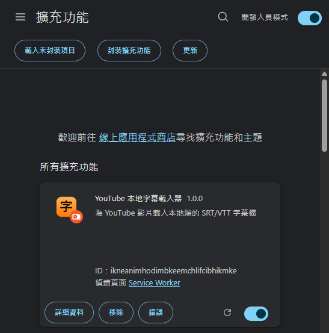
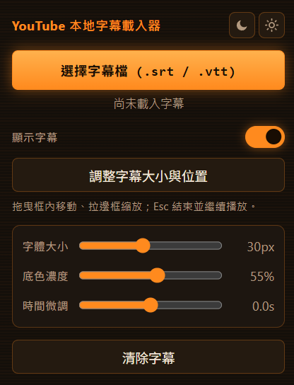

# YouTube 本地字幕載入器

在 YouTube 播放器上顯示本機 SRT / VTT 字幕檔的 Chrome 擴充功能。
本擴充功能只讀取你選擇的字幕檔。它不上傳檔案，也不需要網路連線。

## 目錄

- [開發緣起](#開發緣起)
- [功能](#功能)
- [安裝](#安裝)
- [使用方式](#使用方式)
- [試試看](#試試看)
- [檔案結構](#檔案結構)
- [權限與隱私](#權限與隱私)
- [已知限制](#已知限制)
- [授權](#授權)

## 開發緣起

在 AI 工具大爆發的時代，我們能利用 AI 工具下載英文影片的字幕，並用 AI 翻譯成中文字幕。然而，傳統的做法是必須將影片本體也下載到電腦，才能放在同個資料夾讓播放器載入字幕，但下載會耗費了大量時間與硬碟空間。

> 「既然 YouTube 已經有現成的影片，為什麼我不能直接在瀏覽器裡看，並掛上我翻譯好的字幕？」

為了不再把時間浪費在等待下載與空間佔用上，youtube-local-subtitles 就這樣誕生了。簡單、輕量、直覺，讓你直接在 YouTube 上享受你自己精心準備的字幕！

## 功能

**字幕顯示**

- 支援 `.srt` 與 `.vtt` 字幕格式。
- 字幕覆蓋在 YouTube 播放器上。全螢幕也能顯示。
- 播放時不顯示邊框。只有調整模式會顯示外框。
- 載入字幕時，自動關閉 YouTube 原生字幕。字幕改由本擴充功能接手。
- 廣告播放期間，自動隱藏字幕。廣告結束後，字幕自動恢復。
- 換頁或播放器重建時，字幕會自動重新掛回播放器，並重新套用位置與大小。

**外觀與操作**

- 調整字幕大小與位置。開啟調整模式後，你可以拖曳移動，也可以拉邊框縮放顯示範圍。
- 設定字體大小、底色濃度、時間微調（±5 秒）。
- 用滑動開關顯示或隱藏字幕。
- 切換 Light / Dark 主題。月亮圖示為深色，太陽圖示為淺色。配色為橘色復古未來主義。

**其他**

- 工具列圖示依網域變化。在 YouTube 網域顯示橘色「字」。其他網域顯示灰色「字」。
- 字幕只在本次分頁暫存。重新整理或關閉分頁後，請重新選擇字幕檔。

## 安裝

載入後，你會在 `chrome://extensions` 看到「YouTube 本地字幕載入器」。

1. 開啟 `chrome://extensions`。
2. 開啟右上角的「開發人員模式」。
3. 點「載入未封裝項目」。
4. 選擇本資料夾 `youtube-local-subtitles`。
5. 開啟任一 YouTube 影片。點工具列的「字」圖示。選擇字幕檔。

> 更新版本後，回到 `chrome://extensions`，按本擴充功能的「重新載入」。然後重新整理 YouTube 分頁。

## 使用方式

1. 開啟 YouTube 影片。點工具列的「字」圖示。
2. 按「選擇字幕檔」。挑選本機的 `.srt` 或 `.vtt` 檔。
3. 字幕隨即顯示在播放器上。用滑桿調整外觀。

**調整大小與位置**

1. 按「調整字幕大小與位置」。影片會暫停。字幕外框變成可編輯。
2. 拖曳框內，移動字幕位置。拉動八個邊框控點，縮放顯示範圍。你可以拉寬、拉窄、拉高、拉短。
3. 按 `Esc`，或再點一次按鈕。結束調整。字幕套用新設定。若影片進入調整模式前正在播放，會繼續播放。

調整後的位置與框大小會在換字幕檔時保留。

**小提示**

- 載入後，本擴充功能會自動關閉 YouTube 內建 `CC`。如需原生字幕，請自行再開啟。
- 請以 UTF-8 編碼儲存字幕檔。其他編碼可能出現亂碼。
- 時間對不上時，用「時間微調」滑桿前後校正。

## 試試看

你可以用一段範例影片，快速試用本擴充功能。

1. 開啟這段影片：[Rails World 2026 Opening Keynote - DHH](https://www.youtube.com/watch?v=vDjW_dRyKXY)。
2. 按工具列的「字」圖示。
3. 按「選擇字幕檔」。
4. 選擇本專案內的範例字幕檔：

   `sample\Rails World 2026 Opening Keynote - DHH [vDjW_dRyKXY].zh-Hant.srt`

5. 字幕會在播放器上顯示。播放影片，即可看到中文字幕。

> 影片網址：https://www.youtube.com/watch?v=vDjW_dRyKXY

## 檔案結構

| 檔案 | 說明 |
| --- | --- |
| `manifest.json` | MV3 設定。只要求 YouTube 網域權限。 |
| `parser.js` | SRT / VTT 解析器。popup 與 content script 共用。 |
| `content.js` | 注入字幕 overlay。依 `video.currentTime` 同步。接收 popup 訊息。 |
| `content.css` | 字幕樣式。 |
| `background.js` | 依目前網域切換工具列圖示（橘色／灰色）。 |
| `icons/`、`icons/gray/` | 橘色與灰色的「字」圖示（16 / 32 / 48 / 128）。 |
| `popup.html`、`popup.js` | 選擇檔案與設定介面。 |
| `images/` | 說明用截圖。 |
| `sample/` | 範例字幕檔，供「試試看」使用。 |

## 權限與隱私

- 本擴充功能只要求 `youtube.com` 網域權限。
- 它不需要 `tabs` 權限，也不讀取瀏覽記錄。
- 工具列圖示的橘／灰判斷，是利用「YouTube 分頁的網址可讀取、其他網域為 undefined」達成。因此不需額外權限。
- 字幕內容只存在分頁記憶體中。它不寫入磁碟，也不連外。

## 已知限制

- 字幕為暫存。重新整理頁面後需重新選檔。
- 解析器會移除字幕中的樣式標籤（`<i>`、`<b>`、`{\anX}` 等），只保留純文字。
- 檔案編碼非 UTF-8（如 Big5）可能出現亂碼。

## 授權

本專案採用 [MIT 授權條款](LICENSE)。

Copyright (c) 2026 youtube-local-subtitles contributors

本程式由 AI 產生。你可以自由使用、修改與再散布。
你不需付費，也不需取得同意。歡迎直接動手改。
